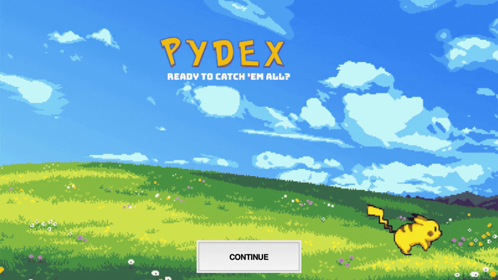

#  PyDex
### Pokémon Collection Management System

PyDex is a Python desktop application for exploring the original 151 Kanto Pokémon and managing a personal collection.

Created by **Claudia Lourenco Barroso** at **Georgia State University — Perimeter College**, the project combines an interest in Pokémon with programming concepts studied in CSC 1301K.

## Features

- **Search Pokémon:** Find a Pokémon by name and view its Pokédex number, artwork, and collection status.
- **My Collection:** View collected Pokémon in an alphabetical, scrollable list.
- **Catch a Pokémon:** Add a Pokémon to the collection, with duplicate checking.
- **Missing Pokémon:** View the Pokémon still needed to complete the collection.
- **Collection Progress:** Track completion with a progress bar and percentage.
- **Graphical Interface:** Navigate through a Tkinter interface with an animated Pikachu welcome screen.

## Technologies

- Python 3
- Tkinter and ttk for the graphical interface
- Pillow for image processing and GIF frames
- PokeAPI for Pokémon names and Pokédex numbers
- PokeAPI's sprite repository for Pokémon artwork

## Programming Concepts

PyDex applies the following concepts:

- **Dictionaries:** Store Pokémon names and Pokédex numbers, and cache downloaded images.
- **Sets:** Store unique collected Pokémon and identify missing Pokémon through set difference.
- **Lists:** Store animation frames.
- **Functions:** Organize the application into reusable operations.
- **Conditionals:** Validate searches and prevent duplicate entries.
- **Loops:** Process Pokémon data, populate lists, and load animation frames.
- **Event handling:** Respond to button clicks and keyboard input.



## How to Run

This is a desktop application. Download and run it locally on a computer with a graphical display.

### 1. Install Python 3

Your Python installation must include Tkinter.

### 2. Download the project

On this repository's main page, select **Code → Download ZIP**, then extract the ZIP file.

### 3. Install Pillow

Open a terminal in the extracted project folder and run:

```bash
python3 -m pip install Pillow
```

### 4. Check the required files

Keep these files together in the same folder:

```text
pydex.py
welcome.png
pikachu.gif
```

### 5. Start PyDex

From that folder, run:

```bash
python3 pydex.py
```

On Windows, use `python` instead of `python3` if needed.

An internet connection is required to load Pokémon data and download artwork.

## Using PyDex

1. Click **CONTINUE** on the welcome screen.
2. Select an option from the main menu.
3. Enter a Pokémon name to search for it or add it to your collection.
4. Explore your collection, missing Pokémon, and completion progress.

Use the names provided by PokeAPI, such as `Pikachu`, `Mr-mime`, or `Nidoran-f`.

## Current Limitations

- The collection is stored in memory and resets when the application closes.
- Each session begins with Pikachu and Bulbasaur in the collection.
- Catching currently adds a valid Pokémon directly; random catch outcomes are planned.
- The application currently covers the Kanto region.
- An internet connection is required at startup.

## Future Development

- Save and reload collection progress.
- Add a separate Shiny Pokédex.
- Include additional Pokémon regions.
- Develop a click-to-catch minigame with catch probabilities.
- Expand the graphical interface and collection tools.

## Academic Context

Developed for **CSC 1301K — Principles of Computer Science I**, by **Dr. Liu**, at Georgia State University.

Prepared for presentation at the **November 2026 Georgia State University STEM Conference**.

## Author

**Claudia Lourenco Barroso**  
Computer Science Student  
Georgia State University 

## Credits

Pokémon data is provided by [PokeAPI](https://pokeapi.co/). Pokémon artwork is accessed through the [PokeAPI sprites repository](https://github.com/PokeAPI/sprites).

Pokémon and related names and characters belong to their respective owners. PyDex is an independent educational fan project and is not affiliated with or endorsed by Nintendo, Game Freak, or The Pokémon Company.
